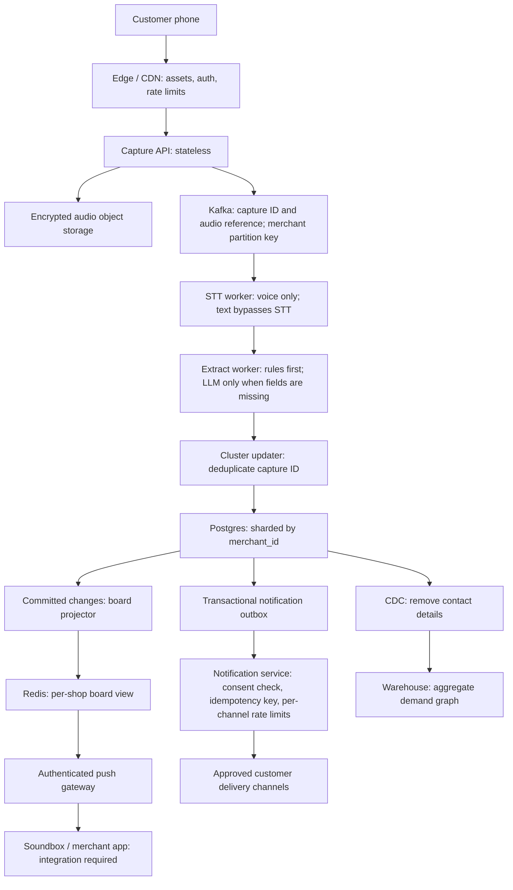

# MAANG scale design

## Summary

Shop data is independent, so storage and processing can shard by merchant.
Peak capture writes are ordinary database work when spread across merchant shards.
AI calls are a harder capacity and cost problem than accepting captures.
Board reads become the other hard part if every open board polls repeatedly.
The rules fallback is the degradation path when AI is slow, unavailable, or over budget.

## Load model

This is a planning envelope, not a measured production capacity claim. One crore is 10,000,000; one lakh is 100,000.

| Input or result | Value and arithmetic | Status |
|---|---|---|
| Paytm subscription merchants | 1.51 crore at FY26 year end, including devices. Historical reference, not MAANG adoption. | Fact |
| Active MAANG shops | 1 crore, an upper bound for this model | Assumption |
| "Nahi hai" moments | 5 to 20 per shop per day | Assumption |
| Scan rate | 10% of those moments become captures; first pilot metric to measure | Assumption |
| Evening multiplier | 3x the daily average | Assumption |
| Festival multiplier | Another 3x, applied together with evening load | Assumption |
| Captures per day | 1 crore x 5 to 20 x 10% = 50 lakh to 2 crore | Derived |
| Average capture rate | 5,000,000 / 86,400 = 58/s; 20,000,000 / 86,400 = 231.5/s, about 230/s at the upper end | Derived |
| Peak capture rate | 231.5 x 3 x 3 = 2,083/s, rounded to about 2,000/s for discussion | Derived |
| Open boards and polling interval | 10 lakh open boards, each polling every 3 seconds | Assumption |
| Board polling traffic | 1,000,000 / 3 = 333,333 requests/s, about 3.3 lakh/s | Derived |
| AI workload boundary | Every peak capture uses voice STT and needs one LLM call; no retries included | Assumption |
| AI at peak | About 2,000 captures/s x 1 STT = 2,000 STT calls/s, plus 2,000 x 1 LLM = 2,000 LLM calls/s | Derived |

FY26 merchant figure: [Paytm FY2026 results](https://paytm.com/support/investor-relations/paytm-fy-2026-results-full-year-profitability-with-pat-at-552-cr-revenue-grows-to-8437-cr).

The AI row is a worst-case call envelope. Text entry avoids STT; rules-complete requests avoid LLM calls. Repair calls and retries consume extra capacity and need their own budget. Provider throughput and cost are unknown, measured in pilot. A capture can cause several database mutations, so 2,000 captures/s is not a database write benchmark.

## Architecture at scale

All components below are proposed MAANG components. No Paytm internal system, Soundbox integration access, or production deployment is assumed.

Return a capture ID after durable acceptance. Store audio before publishing its reference, with capture-ID deduplication covering retries. A board projector consumes committed changes and can rebuild Redis from Postgres. Neither Redis nor the warehouse can approve a reservation.

## Eight design moves

**1. Async capture.** Accept the request, persist its audio or text reference, enqueue work, and return a capture ID. Show processing state on the phone. Consumers retry transient errors with bounded attempts and send exhausted jobs to a dead-letter queue. Deduplicate by capture ID so replay does not create duplicate demand.

**2. AI as a budget.** Run rules before the LLM and call it only for missing fields. Bound provider concurrency, audio duration, retry count, and spend per merchant and globally. Queue lag, timeouts, or provider rate limits trigger backpressure into basic mode: text entry, deterministic extraction, and fixed clarification questions. Voice cannot transcribe without STT, so offer text when STT is unavailable. Provider limits and cost are unknown, measured in pilot.

**3. Partition by merchant.** Use merchant_id as the queue partition key and database shard key; include it in tenant queries and indexes. Reserve stock in one transaction with a per-product row lock or conditional stock decrement and a request idempotency guard. Keep each merchant's request, stock, and reservation together. Monitor hot merchants separately so one large shop cannot stall its neighbours.

**4. Precompute and push boards.** Update a versioned per-shop read model after committed state changes, cache it in Redis, and push board changes over authenticated SSE or WebSocket connections. Reconnect using the last version and fetch a fresh snapshot if events were missed. Push still needs connection and fan-out capacity, but avoids 3.3 lakh full board reads/s. Rebuild views asynchronously; show freshness and keep stock decisions in Postgres.

**5. Notification service.** Write a notification intent into an outbox in the same transaction as the business change. A worker rechecks current consent and request eligibility before delivery, uses an idempotency key per request, event, and channel, and applies per-channel rate limits. Retry with backoff and record provider delivery state separately from notification intent. If a provider lacks idempotent sends, reconcile uncertain outcomes rather than claiming exactly-once delivery.

**6. Identity and privacy.** Integrate Paytm merchant login only through an approved integration and bind access to the authenticated merchant; integration access is unconfirmed. Encrypt phone numbers with managed keys, mask them on boards, and restrict decryption to delivery workers. Keep a DPDP Act 2023 consent log with purpose, notice version, timestamp, and withdrawal; recheck it before sending. Propose 30 to 90 day retention by purpose, delete earlier when no longer needed, and propagate deletion to audio, caches, and analytics. This is a product retention proposal, not a statutory period. Apply edge rate limits by merchant, capture session, and network source.

Consent reference: [DPDP Act 2023, section 6](https://www.meity.gov.in/writereaddata/files/Digital%20Personal%20Data%20Protection%20Act%202023.pdf). Confirm applicable commencement and rules before a real-data rollout.

**7. Observability.** Trace a capture ID across stages without logging phones, keys, or raw audio. Measure stage latency, fallback rate, queue lag, provider errors, cost per capture, board freshness, and notify-to-pickup conversion. Separate failed-call latency from successful latency. Alert on growing lag, spend, and delivery failures; thresholds are unknown, measured in pilot.

**8. Analytics off the hot path.** Use CDC to send committed changes into a warehouse, stripping phones and raw transcripts before building an aggregate demand graph. Batch cross-shop analysis and suppress small groups that could reveal individual shoppers. Warehouse queries never scan the live reservation tables. Track CDC lag and support replay and deletion propagation.

## Demo today vs at scale

Demo column describes this branch's inspected source, not a verified live deployment.

| Area | Demo today | At scale, proposed |
|---|---|---|
| Board updates | Browser polls about every 3 seconds after each completed load | Authenticated push, versioned snapshots, reconnect recovery |
| AI | App adapter uses rules stub; separate Sarvam library passed 14 live calls after reasoning was disabled; app adapter remains the rules stub | Queued STT, rules first, selective LLM calls, bounded spend and fallback |
| Database | Supabase Postgres schema with request locking and conditional stock decrement | Postgres shards by merchant_id; tenant-scoped transactions and per-product locks |
| Board data | Server loads products, requests, and events and computes board on read | Incremental per-shop read model in Redis, rebuilt from Postgres |
| Merchant auth | Shared merchant key checked by server | Approved Paytm merchant login integration and merchant-scoped authorization |
| Rate limits | In-memory sliding window per server instance | Distributed edge and service limits with provider concurrency budgets |
| Notifications | Consent-gated database transition and event; no external delivery proved | Transactional outbox, delivery workers, consent recheck, idempotency, channel quotas |
| Hosting | Next.js app source; live hosting and capacity unverified | Edge assets, stateless APIs, independently scaled workers and push gateway; sizing unknown, measured in pilot |
| Data | Seeded demo shop and synthetic requests; real-data handling not validated | Consented pilot data, encrypted contacts, retention and deletion controls, aggregate analytics |

## Rollout

Expand only after the previous stage's failures, queue replay, consent withdrawal, and stock contention have been checked. A city is a rollout boundary, not a fixed shop count.

| Stage | What breaks first | Gate before expansion |
|---|---|---|
| 50 pilot shops | AI cost, latency, and provider rate limits | Measure scan rate and cost per capture; verify rules and text degradation, consent, and stock reservation races |
| 10k shops | AI concurrency and quota pressure, then repeated board reads | Bound provider spend and queues; move board computation to a read model and push; load-test reconnect bursts |
| A city | Board connections, fan-out, view freshness, then notification quotas | Exercise gateway failover, rebuild board views, and prove channel throttling and outbox recovery |
| All India | Notification quotas during coordinated peaks, plus hot shards and regional failures | Confirm channel capacity, isolate merchants, rehearse regional failover and replay, and gate rollout by measured capacity |

AI cost and rate limits come first, board reads next, and notification quotas after that in this planning sequence. Actual order and safe expansion thresholds are unknown, measured in pilot.

## Measured today

QA owns these values. No load or latency claim is inferred from code inspection.

| Check | Value |
|---|---|
| Concurrent reserve test: one ok out of N contenders for one remaining unit | 1/10 ok; stock 0; negative stock 0 |
| Extract latency p50, AI | 1,560.0 ms (5 runs; max 1,787.8 ms) |
| Extract latency p50, rules | 489.5 ms (5 runs; max 523.8 ms) |
| Rate limit observations | 7/15 returned 429; remaining 8 returned 201; per-instance Vercel observation |
| Board read p50 at 30 concurrent | 762.4 ms; 0/30 errors |
| Board read p95 at 30 concurrent | 1,034.7 ms; 0/30 errors |

## Open questions

| Question | Current answer | Pilot measurement |
|---|---|---|
| What fraction of "Nahi hai" moments become scans? | unknown, measured in pilot | Count eligible moments and completed captures, including abandonment |
| What is cost per capture? | unknown, measured in pilot | Record billed audio, LLM usage, retries, and fallback share per completed capture |
| What are Sarvam throughput limits? | unknown, measured in pilot | Confirm account quotas with provider, then measure approved concurrency, latency, and rate-limit responses |
| How do chains map free text to their SKU catalog? | unknown, measured in pilot | Measure catalog candidate coverage, ambiguity, human confirmation and wrong-match rate |
| What do notification channels cost? | unknown, measured in pilot | Confirm approved channel pricing and delivery quotas; measure sends, failures, retries, and pickup conversion |

## Merchant tiers

Enrich and Croma are examples of business formats only. This document does not claim either is a Paytm merchant or partner. The demo is one store; none of the multi-store design below is built today.

| Tier | What "nahi hai" means | Capture mode | Recovery action | Who sees demand | Integration |
|---|---|---|---|---|---|
| Micro: kirana, specialty shop | Item out of stock | Customer QR and Soundbox | Restock and notify | Owner | None |
| Mid-size outlet: independent salon, pharmacy, apparel store, 1 to 20 outlets | No slot, size or colour | Staff-assisted counter device plus QR | Waitlist or source by evening | Owner and store manager | Billing app |
| Service chain: Enrich-style salon chain, many outlets across cities | No slot or stylist free at this outlet; retail product such as shampoo out of stock | Front desk or booking app plus QR | Offer nearest outlet with a free slot, waitlist, fill cancellations | Outlet manager, city and HQ | Booking system and POS |
| Retail chain: Croma-style electronics chain, hundreds of stores | Model, colour or variant missing at this store | Staff app or POS lost-sale button plus QR | Transfer from another store, home delivery or restock | Store, region and HQ category buyers | SKU catalog, POS, ERP |

## Multi-store design

**Tenancy.** Model org -> store -> counter. Put org_id and store_id on every operational row, with counter_id where relevant, and enforce roles at each level. A shared merchant login must not grant access to unrelated stores or organizations. Reserve cross-store lookup permission separately from stock-changing permission.

**Products and services.** The proposed request model references an offer type: product SKU or service slot. An Enrich-style salon slot and a Croma-style phone variant can use the same request and recovery workflow. Nearest-outlet routing finds a candidate for either, then the owning store confirms availability. Product reservations consume stock; service reservations consume a time interval, staff and resource capacity. Current ExtractedRequest lacks these structured offer and routing fields; this requires a future contract change, not a claim of current support.

**Catalog matching.** Rules and AI map free text to candidates in the organization's catalog. Match SKU variants, service duration and stylist requirements against authoritative identifiers. A human confirms unknown or ambiguous matches before a promise or reservation. Do not map a medicine to a substitute or infer dosage; pharmacy staff confirms the requested product. Catalog coverage and matching cost are unknown, measured in pilot.

**HQ rollup.** Aggregate demand asynchronously by org, region and item through CDC and the warehouse. Give store managers their operational board and HQ category buyers aggregate trends. Never compute chain-wide analytics on the capture or reservation hot path; publish rollup freshness.

**Hot tenants.** A large chain is a hot tenant. Map merchant_id to the organization boundary and distribute its stores across store_id shards inside that organization. Keep each store's inventory or booking transactions local. Cap per-org AI spend and per-store concurrency; cross-store transfers use explicit workflows rather than a transaction across all stores.

**Load and data shape.** Chains change the data shape more than the basic capture pattern: fewer organizations, many stores, catalogs, service slots and deeper analytics. Count stores, not organizations, in the active-shop load model. Chain campaigns and HQ reads can still create correlated bursts; measure those separately. Keep the 5 to 20 moments and 10% scan rate as assumptions until each tier is sampled. Include all four tiers in the 50-shop pilot.
